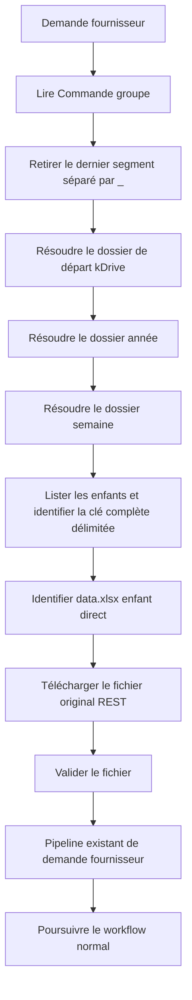

# Demande fournisseur — Import automatique de data.xlsx depuis kDrive

> Statut : cadré, avec hypothèses d'intégration à vérifier dans le dépôt.
> Dernière mise à jour : 26 novembre 2026 — révision 3 (chemin réel fourni, semaine sur deux chiffres, référence dans le nom du dossier).
> Nature : évolution ciblée d'une application existante, et non création d'une nouvelle application.
> Référence fonctionnelle : ce brief fait foi pour cette évolution. La documentation technique complémentaire est `docs/infomaniak-kdrive-api.md` (déjà rédigée séparément).

## 1. Vision et résultat attendu

Le traitement d'une demande fournisseur nécessite un fichier Excel nommé `data.xlsx`. Aujourd'hui, le fichier doit être fourni à l'application ; l'objectif est de supprimer cette manipulation manuelle en le récupérant automatiquement dans le kDrive Infomaniak de l'organisation.

La demande fournisseur contient ou permet d'obtenir une valeur métier nommée **Commande groupe**. Elle permet de déterminer la référence métier à rechercher dans le nom du dossier kDrive dans lequel se trouve le fichier. L'application doit retrouver le bon dossier, télécharger le fichier Excel original et l'injecter dans le traitement de la demande fournisseur existant, sans que l'utilisateur ait à rechercher le fichier, le télécharger sur son poste puis le téléverser manuellement.

Le terme « upload automatique » désigne ici l'import **dans l'application**, depuis kDrive. Aucun fichier ne doit être envoyé vers kDrive, modifié ni supprimé sur kDrive par cette fonctionnalité.

Succès observable : à partir d’une demande portant la référence illustrative `46_26S5_94_1`, l’application déduit la clé `46_26S5_94`, résout `FRANCAIS/2026/S05`, identifie le dossier `fact_46_26S5_94_RUNGIS` du chemin réel fourni par l’utilisateur (F-03), télécharge son `data.xlsx` et le traite exactement comme le fichier fourni manuellement. Le suffixe `_1` de cette valeur d’entrée est illustratif : seul le chemin kDrive a été fourni pour cet exemple.

## 2. Utilisateurs, rôles et permissions

- Acteur principal : utilisateur déjà habilité à traiter une demande fournisseur dans l'application.
- L'intégration utilise le kDrive de l'organisation, avec une configuration et un token API conservés exclusivement côté serveur.
- Les règles d'accès actuelles de l'application aux demandes fournisseur restent applicables. Le token kDrive ne constitue pas une autorisation de consulter toutes les données de l'organisation depuis la WebApp.
- Le backend limite la résolution et le téléchargement au sous-arbre désigné ci-dessous. Aucune interface d'exploration générale de kDrive n'est nécessaire.
- [À CONFIRMER] Le compte kDrive qui porte le token doit avoir accès au dossier de l'organisation et aux fichiers concernés. Vérifier également les règles d'accès de l'application, sans inventer de nouveaux rôles.

## 3. Périmètre MVP

### P0 — Indispensable

- Configurer et valider la connexion REST au bon kDrive et au dossier métier.
- Récupérer la valeur `Commande groupe` de la demande fournisseur en cours.
- En dériver la clé de recherche du dossier par suppression du dernier séparateur `_` et de tout ce qui le suit.
- Résoudre et identifier de manière non ambiguë le dossier exact dans la hiérarchie obligatoire `FRANCAIS/<année>/<semaine>/<dossier commande>` ; naviguer directement par année et semaine selon la convention vérifiée, puis identifier le dossier dont le nom contient la clé complète délimitée (préfixe/suffixe possibles).
- Trouver le fichier `data.xlsx` directement dans le dossier identifié, contrôler ses métadonnées et télécharger ses octets originaux.
- Transmettre le fichier au mécanisme de traitement/import Excel existant, sans introduire de logique métier Excel parallèle.
- Afficher un état de progression et des erreurs explicites ; empêcher un traitement avec un fichier incorrect, incomplet ou associé à une autre demande.
- Prévenir les effets de double déclenchement et les réponses tardives lorsque la commande change.

### P1 — Améliorations éventuelles

- Diagnostic de connexion dans les outils d'administration existants, si utile ; aucune nouvelle page d'administration n'est exigée.
- Mise en cache limitée de l'identifiant du dossier racine métier, avec revalidation et invalidation ; uniquement si cela améliore réellement l'intégration.

### Hors périmètre

- MCP, WebDAV, IA, RAG, index global de kDrive ou synchronisation permanente.
- Écriture, création, renommage, déplacement, partage ou suppression de fichiers sur kDrive.
- Explorateur générique de fichiers, choix automatique d'un autre XLSX si `data.xlsx` manque, recherche hors du périmètre autorisé.
- Refonte de la demande fournisseur, du traitement Excel, de l'architecture de l'application ou de son modèle d'authentification.
- Traitement par lot de plusieurs demandes fournisseur et automatisation planifiée en arrière-plan, sauf besoin déjà établi dans le code existant.

## 4. Parcours de bout en bout

1. L'utilisateur ouvre ou initie une demande fournisseur dans le workflow existant.
2. L'application dispose de la valeur `Commande groupe` associée à cette demande. Elle la valide et en déduit la clé de recherche du dossier.
3. Le backend résout le dossier de départ kDrive `FRANCAIS`, puis le dossier annuel, le dossier hebdomadaire et le dossier commande exact, en respectant la hiérarchie de F-03. Il exploite l’année et la semaine encodées dans la référence, avec semaine sur deux chiffres, puis compare les noms des dossiers enfants à la clé complète selon F-03.
4. Il identifie `data.xlsx` comme fichier enfant direct du dossier trouvé.
5. Il vérifie l'appartenance au périmètre, les droits et les métadonnées, puis télécharge le fichier original via l'API REST.
6. Il valide le fichier et le remet au pipeline d'import/traitement déjà utilisé pour les demandes fournisseur. Si le pipeline exige un fichier téléversé, adapter l'entrée au serveur plutôt que de réécrire son traitement ; ne pas déclencher un téléchargement sur le poste utilisateur.
7. L'application confirme le succès uniquement après réception/validation par le pipeline existant et poursuit le workflow normal.
8. Si une étape échoue, l'application identifie le problème, ne traite aucun fichier de substitution et permet une nouvelle tentative. Si un import manuel existe déjà, le conserver comme solution de secours selon les règles actuelles [HYPOTHÈSE].

[HYPOTHÈSE] Le déclenchement se fait automatiquement au moment où la demande fournisseur dispose d'une `Commande groupe` valide et où son workflow a besoin de `data.xlsx`. Codex doit identifier le point d'intégration réel dans le code : ne pas déclencher une requête kDrive à chaque frappe clavier, au simple rendu de l'écran ou sur une valeur intermédiaire. Si le workflow a déjà une étape explicite de lancement, se raccorder à cette action.

### Schéma fonctionnel



À toute étape, une erreur bloque l'import automatique de cette demande et retourne un diagnostic adapté.

## 5. Fonctionnalités et critères d'acceptation

### F-01 — Configuration et validation de la connexion kDrive

Utiliser l'API REST officielle d'Infomaniak avec la configuration serveur `KDRIVE_TOKEN` et `KDRIVE_ID` (ou les noms équivalents déjà employés dans le dépôt). Le token doit disposer du scope `drive` et des droits nécessaires sur les ressources. Le chemin de départ est celui de F-03. Consulter les sections 3, 4, 5 et 6 de `docs/infomaniak-kdrive-api.md`.

- **AC-01** : avec une configuration valide, un contrôle en lecture seule identifie le bon drive, résout le chemin de départ et vérifie qu'il est accessible ; une validation réelle complète comprend le téléchargement d'un fichier de test autorisé.
- **AC-02** : un token absent, invalide, expiré, un identifiant de drive erroné ou des droits insuffisants entraîne une erreur distincte et exploitable ; aucun secret n'est affiché ni journalisé.
- **AC-03** : les tests de connexion sont exécutables indépendamment du traitement fournisseur et ne modifient aucune donnée kDrive. Le succès de la connexion au drive seul n'est pas confondu avec le droit de télécharger dans le dossier cible.

### F-02 — Déterminer la clé de recherche à partir de Commande groupe

**Règle métier décidée :** retirer le dernier caractère `_` ainsi que tous les caractères situés après celui-ci. Conserver intégralement le préfixe, y compris les autres `_`, lettres, chiffres et éventuels zéros initiaux. Ne pas convertir la référence en nombre ni supposer que le dernier segment est toujours `1`.

```text
Commande groupe : 529_26S46_81_1
Dernier segment : _1
Clé de recherche : 529_26S46_81
```

Pseudo-code indépendant de la stack :

```text
function deriveFolderKey(raw):
    si raw n'est pas une chaîne : erreur COMMANDE_GROUPE_INVALIDE
    value = raw.trim()
    i = position du dernier "_" dans value
    si i <= 0 ou i == longueur(value) - 1 : erreur COMMANDE_GROUPE_INVALIDE
    prefix = value[0:i]
    si value contient un séparateur de chemin, un caractère de contrôle,
       ou des segments vides selon le format métier retenu : erreur
    retourner prefix
```

[HYPOTHÈSE] Le nettoyage des espaces externes est toléré. Les références comportant des segments vides, une absence de suffixe ou des séparateurs de chemin sont rejetées ; ne pas imposer une expression régulière rigide sur la longueur ou le contenu des segments sans vérifier les données métier existantes.

| Commande groupe | Résultat attendu |
|---|---|
| `529_26S46_81_1` | `529_26S46_81` |
| `46_26S5_94_1` (entrée illustrative correspondant au chemin fourni) | `46_26S5_94` |
| `529_26S46_81_2` | `529_26S46_81` |
| `529_26S46_81_12` | `529_26S46_81` |
| `007_26S46_081_1` | `007_26S46_081` |
| ` 529_26S46_81_1 ` | `529_26S46_81` |
| valeur vide, nulle ou non textuelle | erreur de validation |
| `52926S46811` | erreur : séparateur absent |
| `529_26S46_81_` | erreur : suffixe absent |
| `_1` ou `529__81_1` | erreur : préfixe/segment invalide |
| `../../529_26S46_81_1` | erreur : référence non sûre |

- **AC-04** : les exemples valides retournent exactement les clés ci-dessus, sans altération du reste de la référence.
- **AC-05** : une valeur invalide ne déclenche aucune requête kDrive ni aucun traitement Excel.
- **AC-06** : la valeur provient de la demande fournisseur en cours, pas d'une donnée résiduelle provenant d'une autre demande.

### F-03 — Localiser le dossier kDrive dans la hiérarchie année/semaine

**[DÉCIDÉ]** Le fichier est sous `FRANCAIS/<année>/<semaine>/<dossier commande>/data.xlsx`. Le dossier commande n'est pas un enfant direct de `FRANCAIS`. Son nom réel peut être plus long que la clé dérivée de F-02.

**Chemin réel communiqué par l’utilisateur le 26 novembre 2026** (à conserver tel quel dans les fixtures de référence) :

```text
/04_SUIVI_COMMANDE/03_FACTURE/FRANCAIS/2026/S05/fact_46_26S5_94_RUNGIS/data.xlsx
```

```text
(racine des dossiers de l'organisation)
└── 04_SUIVI_COMMANDE/
    └── 03_FACTURE/
        └── FRANCAIS/
            └── 2026/
                └── S05/
                    └── fact_46_26S5_94_RUNGIS/
                        └── data.xlsx
```

Le libellé « Dossiers de l'organisation » n'apparaît pas dans le chemin fourni : il peut désigner une racine virtuelle de l'interface kDrive plutôt qu'un enfant ordinaire de la racine API. Ne pas le préfixer automatiquement au chemin ni inventer un ID. Identifier le dossier `FRANCAIS` réel, vérifier son ascendance et éventuellement configurer `KDRIVE_BASE_FOLDER_ID` avec son ID vérifié côté serveur. Le chemin communiqué est un chemin métier, pas une URL d'API.

#### 1. Année et semaine

**Observation établie par l'exemple :** `26S5` figure dans le nom du dossier sous `2026/S05`. Le nom du dossier semaine comporte un zéro initial, alors que la référence métier n'en comporte pas. **[HYPOTHÈSE]** Généraliser la conversion suivante, à vérifier sur des exemples représentatifs avant mise en service réelle : le deuxième segment séparé par `_` suit `YY` + `S` + numéro de semaine ; `YY` correspond à l'année sur quatre chiffres (par exemple `26` → `2026`), et le dossier semaine est `S` suivi du numéro sur deux chiffres (`5` → `S05`). Ne pas déduire l'année ou la semaine de la date courante.

| Commande groupe (valeurs illustratives) | Clé à conserver sans modification | Année | Dossier semaine |
|---|---|---|---|
| `46_26S5_94_1` | `46_26S5_94` | `2026` | `S05` |
| `529_26S46_81_1` | `529_26S46_81` | `2026` | `S46` |
| `529_26S46_81_12` | `529_26S46_81` | `2026` | `S46` |
| `007_25S2_081_1` | `007_25S2_081` | `2025` | `S02` |
| `529_26S01_81_1` | `529_26S01_81` | `2026` | `S01` |

- Extraire le segment temporel et contrôler la semaine (1 à 53). Confirmer le mapping des années sur deux chiffres pour le périmètre historique. Préserver intégralement la clé métier ; `46_26S5_94` ne devient jamais `46_26S05_94` pour la recherche du dossier commande.
- Résoudre les dossiers année et semaine par nom exact dans leur parent vérifié. Le dossier `S05` est prioritaire selon la convention observée ; ne pas substituer silencieusement `S5`, une autre année ou une autre semaine. Si des variantes existent dans les données réelles, documenter une règle explicite et non ambiguë avant de les accepter.
- Si la convention ne peut pas être validée, ne pas deviner un chemin. Un diagnostic ciblé sous `FRANCAIS` peut aider à confirmer la convention, sans déclencher d'import depuis une branche non vérifiée. Ne pas balayer l'ensemble de kDrive.

#### 2. Identifier le dossier commande à l'intérieur de la semaine

La clé `46_26S5_94` est une référence, pas nécessairement le nom complet du dossier. L'exemple réel `fact_46_26S5_94_RUNGIS` montre un préfixe `fact_` et un suffixe `_RUNGIS`. Il n'établit pas que ces affixes sont constants. Ne pas reconstruire un nom complet en dur.

**[HYPOTHÈSE DE MATCHING, à valider sur le classement réel]** Retenir comme candidats les dossiers enfants directs du dossier semaine dont le nom contient la clé entière, contiguë, délimitée à gauche et à droite par un début/fin de nom ou par `_`. Comparaison exacte de la clé (casse et zéros conservés). Cette règle permet un nom strictement égal à la clé, ou un préfixe et/ou un suffixe séparé par `_`. Elle évite les collisions telles que `94` et `940`. Ne pas utiliser un simple `includes(key)` ou une recherche approximative comme preuve de correspondance.

Pseudo-code de matching indépendant de la stack :

```text
function matchesKey(folderName, key):
    return ("_" + folderName + "_").contains("_" + key + "_")
```

Cette fonction produit des candidats, pas une autorisation de téléchargement. Vérifier le type dossier, le parent, le périmètre, l'éventuelle convention de dossier actif (archives/copies) et l'unicité de la correspondance. Confirmer ces règles avec le code métier ou des exemples réels ; ne pas supposer qu'un suffixe arbitraire désigne toujours un dossier actif. Si la convention métier ne permet pas de départager ou si plusieurs dossiers correspondent, bloquer l'import et retourner un diagnostic. Ne pas départager par date, par présence de `data.xlsx`, par premier résultat ou par correspondance exacte privilégiée en présence d'un autre candidat. Un nom de type `..._ARCHIVE` ne doit pas être traité comme actif sans règle de classement vérifiée.

| Nom candidat, pour la clé `46_26S5_94` | Résultat du test de référence délimitée |
|---|---|
| `fact_46_26S5_94_RUNGIS` | oui — exemple réel |
| `46_26S5_94` | oui — exemple synthétique |
| `fact_46_26S5_94_AUTRE` | oui — exemple synthétique, à valider par la convention métier |
| `fact_46_26S5_940_RUNGIS` | non |
| `fact_146_26S5_94_RUNGIS` | non |
| `fact_46_26S50_94_RUNGIS` | non |
| `fact_46_26S05_94_RUNGIS` | non, ne pas normaliser la clé métier |
| `fact_46_26S5_94_ARCHIVE` | oui au test de référence, mais statut actif non établi ; jamais sélectionné automatiquement comme archive |

#### 3. Algorithme privilégié

1. Récupérer l'identifiant vérifié de `FRANCAIS` dans le drive configuré.
2. Résoudre l'enfant dossier année par nom exact (`2026`).
3. Résoudre l'enfant dossier semaine par nom exact (`S05`).
4. Lister les enfants directs de `S05` avec pagination, filtrer le type dossier et la clé complète délimitée, contrôler le parent et la convention métier. Exiger une résolution unique et sûre avant téléchargement. Ne pas utiliser une résolution par nom exact sur la clé comme seule recherche : le nom réel contient potentiellement des affixes.
5. Dans le dossier commande retenu, résoudre le fichier enfant direct de nom exact `data.xlsx` (F-04), vérifier ses métadonnées et télécharger par identifiant.

Pour les niveaux de nom connu, utiliser la résolution par nom (`GET /3/drive/{drive_id}/files/{parent_id}/name?name=...`) si son contrat permet de confirmer parent, type et unicité. Pour le dossier commande, privilégier `GET /3/drive/{drive_id}/files/{parent_id}/files` avec pagination complète et filtrage local. `files/search` est facultatif, par exemple pour le diagnostic, et ne fournit que des candidats à vérifier : une recherche indexée ou partielle ne prouve pas l'absence ou l'unicité. Respecter les paramètres et versions API de la documentation technique ; ne pas inventer de route ou de filtre.

- **AC-07** : avec une fixture reproduisant le chemin réel et la valeur illustrative `46_26S5_94_1`, la clé est `46_26S5_94`, la branche est `2026/S05` et le dossier unique trouvé est `fact_46_26S5_94_RUNGIS`. Avec `529_26S46_81_1`, la branche est `2026/S46` et la clé est `529_26S46_81`, indépendamment du nom complet du dossier. Vérifier parent, type et ascendance.
- **AC-08** : les correspondances valides de la table ci-dessus sont détectées comme candidats ; les faux positifs numériques, temporels, les fichiers portant ces noms, les dossiers hors branche et les dossiers à une profondeur incorrecte sont exclus. Tester la conversion `S5` et `S05` vers le dossier `S05` sans altérer la clé d'origine, les semaines 1–53 et les changements d'année. Ne pas traiter les archives/copies dont l'éligibilité n'est pas établie.
- **AC-09** : année, semaine ou dossier absent, plusieurs correspondances (même si une seule contient `data.xlsx`), statut actif incertain, convention non résolue, pagination incomplète ou ascendance non vérifiable bloque l'import avec un diagnostic précis. Ne jamais choisir le premier résultat ni substituer un homonyme d'une autre branche.
- **AC-10** : toutes les pages pertinentes du dossier semaine sont examinées ou l'opération échoue explicitement. Aucune recherche globale ni balayage récursif de l'ensemble de kDrive n'est nécessaire en fonctionnement normal. Les éventuels diagnostics ciblés ne déclenchent pas d'import avant confirmation de la branche et de l'unicité.

### F-04 — Identifier et télécharger data.xlsx

Dans le dossier commande résolu, rechercher le fichier enfant direct dont le nom est exactement `data.xlsx` et le type est fichier. Utiliser de préférence la résolution par nom dans le parent, ou lister les enfants avec pagination. Vérifier le parent et l'ascendance à partir des données API. Télécharger l'original par identifiant de fichier, non par URL de partage ni par nom local. Le nom cible n'est pas dérivé de `Commande groupe`.

[HYPOTHÈSE] La casse et l'orthographe de `data.xlsx` sont exactes. Ne pas sélectionner `Data.xlsx`, `data (1).xlsx`, `data_old.xlsx`, `~$data.xlsx` ou un fichier présent uniquement dans un sous-dossier de la commande. Une éventuelle tolérance de casse devra être décidée explicitement, sans ambiguïté.

- **AC-11** : le fichier exact `data.xlsx` du bon dossier est récupéré via son identifiant, sous forme d'octets binaires originaux.
- **AC-12** : si `data.xlsx` n'existe pas, n'est pas un fichier ou ne peut pas être identifié de façon unique, aucune substitution et aucun traitement ne sont réalisés.
- **AC-13** : le backend refuse tout fichier dont le parent, le périmètre ou l'autorisation ne peuvent pas être vérifiés, y compris si le fichier a été déplacé entre la recherche et le téléchargement.
- **AC-14** : une réponse HTTP en échec, une réponse d'erreur JSON/HTML déguisée, un fichier vide, un transfert interrompu, un fichier corrompu ou trop volumineux pour les limites de l'import existant ne déclenche aucun traitement métier. Vérifier le véritable format XLSX via le parseur/validateur existant, pas seulement le nom ou le MIME ; prendre en compte le fait qu'un XLSX est une archive ZIP. Ne pas exiger un MIME précis si le fournisseur retourne un type binaire générique valide.

### F-05 — Import et traitement dans la demande fournisseur

Réutiliser le pipeline actuel : même contrat d'entrée, validations Excel, règles métier, messages métier et résultats que l'import manuel. Si le pipeline est actuellement couplé à un formulaire multipart, adapter la frontière d'import à un flux/fichier serveur en conservant les garanties de sécurité. Aucune modification du format attendu de `data.xlsx` sans demande explicite.

- **AC-15** : avec le même fichier et les mêmes données de demande, l'import automatique produit le même résultat métier que l'import manuel de référence.
- **AC-16** : le fichier est associé à la demande et à la valeur `Commande groupe` qui ont lancé l'opération. Un changement de commande pendant une récupération empêche le résultat obsolète de remplacer ou traiter les données de la nouvelle demande.
- **AC-17** : un double déclenchement concurrent ou une nouvelle tentative après erreur ne provoque ni double traitement ni écrasement silencieux d'un fichier déjà validé. Réutiliser les protections d'idempotence existantes ou en prévoir une au niveau de l'opération, en respectant les règles existantes de retraitement volontaire.
- **AC-18** : afficher un succès seulement si le traitement/import existant a accepté le fichier ; en cas d'échec, ne pas marquer la demande comme traitée, conserver l'intégrité de ses données et nettoyer les fichiers temporaires.
- **AC-19** : si l'import manuel est déjà disponible, il continue de fonctionner et respecte les règles existantes de validation/remplacement. Une erreur automatique n'injecte pas de fichier obsolète.

### F-06 — États utilisateur et gestion des erreurs

Intégrer les retours dans l'écran existant sans créer un nouvel écran métier. Les états doivent rester compréhensibles sans exposer les détails techniques ou les secrets.

| Situation | Message indicatif | Action |
|---|---|---|
| Référence absente/invalide | « Commande groupe manquante ou invalide. » | Corriger la référence |
| Connexion/configuration invalide | « Connexion à kDrive indisponible. » | Faire vérifier la configuration |
| Droits insuffisants | « Accès au dossier ou fichier kDrive refusé. » | Faire vérifier les droits |
| Dossier de départ introuvable | « Dossier de départ kDrive introuvable. » | Vérifier la configuration |
| Dossier annuel introuvable | « Dossier année [année] introuvable dans FRANCAIS. » | Vérifier le classement et la convention année |
| Dossier semaine introuvable | « Dossier [semaine] introuvable dans [année]. » | Vérifier le classement et la convention semaine |
| Dossier commande introuvable | « Aucun dossier correspondant à [référence] dans [année]/[semaine]. » | Vérifier le classement, réessayer |
| Année/semaine non résolue | « Impossible de confirmer l’année ou la semaine de cette commande. » | Vérifier la convention de nommage ou le chemin réel |
| Plusieurs dossiers correspondants ou statut actif non établi | « Impossible de sélectionner un dossier unique et valide pour [référence]. » | Corriger le classement ; aucun choix automatique |
| Recherche incomplète | « Impossible de confirmer le dossier de manière fiable. » | Réessayer ou faire vérifier l'intégration |
| Fichier absent/ambigu | « data.xlsx introuvable ou non identifiable dans le dossier. » | Vérifier le contenu du dossier |
| Réseau / 429 / 5xx | « Récupération kDrive temporairement indisponible. » | Réessayer selon politique de reprise |
| Fichier invalide | « Le fichier data.xlsx n'est pas exploitable. » | Vérifier le fichier source |
| Erreur métier Excel | Message de validation du pipeline existant | Corriger les données conformément au workflow |
| Succès | « data.xlsx récupéré depuis kDrive et importé. » | Continuer le workflow existant |

- **AC-20** : pendant l'opération, l'utilisateur voit un état de chargement et ne peut pas déclencher plusieurs imports concurrents pour la même demande.
- **AC-21** : les erreurs ne sont pas confondues avec un succès ; après une erreur récupérable, une tentative explicite est possible sans créer de doublon.
- **AC-22** : les messages et états sont lisibles, accessibles au clavier/lecteur d'écran selon les conventions UI existantes, et n'exposent ni bearer token, ni URL signée, ni contenu Excel sensible.

## 6. Modèle métier et données

Modèle conceptuel uniquement ; ne pas créer de table ou migration sans nécessité établie.

| Donnée | Origine / rôle |
|---|---|
| Identifiant de demande fournisseur | Application existante ; corrélation de l'opération |
| `Commande groupe` | Champ métier existant ; valeur source |
| Clé de recherche dérivée | Valeur calculée par F-02, distincte du nom réel du dossier |
| Année et semaine de classement | Valeurs calculées selon convention vérifiée ou établies par ascendance réelle (F-03) |
| `drive_id` | Configuration backend |
| ID du dossier de départ | Résolution du chemin ou configuration validée |
| ID des dossiers année et semaine | Résolution exacte dans leurs parents respectifs |
| ID et nom réel du dossier commande | Candidat unique contenant la clé complète, selon F-03, enfant du dossier semaine vérifié |
| `file_id`, nom, parent, taille, version/etag si disponible | Métadonnées de référence pour le téléchargement |
| Contenu binaire original | Transitoire ou persisté par le pipeline selon le fonctionnement existant |
| État d'opération | En attente, recherche, téléchargement, validation/import, succès ou erreur ; adapter aux états existants |

Ne conserver que les métadonnées et fichiers utiles selon les règles de conservation actuelles. Pas de copie permanente supplémentaire ni de nouvelle base de données imposée. Ne pas réutiliser silencieusement une copie ancienne si kDrive devient indisponible.

## 7. UX/UI

- Réutiliser l'écran, les composants et les conventions visuelles de la demande fournisseur existante.
- L'automatisation doit éviter à l'utilisateur une action de sélection ou de téléversement lorsque tout fonctionne.
- Informer de la recherche, du téléchargement et de l'import, sans afficher l'arborescence de toute l'organisation.
- Afficher si pertinent la référence de commande, le nom du dossier résolu et `data.xlsx`, sans exposer de données d'autres demandes.
- [HYPOTHÈSE] Conserver l'import manuel existant comme repli, s'il existe. Ne pas créer un nouvel écran de sélection générique ou inventer de règles de priorité entre import manuel et automatique : respecter celles du workflow réel.

## 8. Contraintes techniques et intégrations

### 8.1 Documentation de référence

Lire `docs/infomaniak-kdrive-api.md` intégralement avant d'implémenter le connecteur. Les sections 3–8, 10 et 13 sont directement pertinentes ; les opérations d'écriture décrites dans cette documentation ne sont pas requises pour ce projet. Sources : [portail développeur Infomaniak](https://developer.infomaniak.com/docs/api), [client REST officiel](https://github.com/Infomaniak/mcp-server-kdrive/blob/main/src/kdrive-client.ts). Le code du MCP sert uniquement de référence des appels REST ; ne pas installer ni utiliser le MCP.

### 8.2 Appels REST utiles

Base : `https://api.infomaniak.com` ; authentification `Authorization: Bearer <token>`. Les méthodes ci-dessous sont celles de la documentation complémentaire ; vérifier les contrats de réponse et paramètres réellement disponibles.

| Opération | Méthode et endpoint |
|---|---|
| Contrôler le drive | `GET /2/drive/{drive_id}` |
| Résoudre un enfant par nom | `GET /3/drive/{drive_id}/files/{parent_id}/name?name=...` |
| Lister les enfants | `GET /3/drive/{drive_id}/files/{parent_id}/files` (pagination `cursor` selon réponse) |
| Rechercher des candidats dans le périmètre (facultatif ; la liste du dossier semaine est privilégiée) | `GET /3/drive/{drive_id}/files/search` avec `query`, `directory_id`, `depth`, `limit` ; vérifier la hiérarchie année/semaine |
| Vérifier les métadonnées/ascendance | `GET /3/drive/{drive_id}/files/{file_id}` (par ex. `with=path` selon contrat) |
| Télécharger l'original | `GET /2/drive/{drive_id}/files/{file_id}/download` |

**Attention :** les endpoints ne sont pas uniformément en v3. Ne pas remplacer la route de téléchargement v2 par une route v3 inventée. Le chemin par nom se résout à partir d'un identifiant de parent, et non par concaténation d'une URL de téléchargement. Utiliser l'encodage URL des paramètres et distinguer les réponses JSON de métadonnées des réponses binaires.

### 8.3 Intégration dans l'application existante

Codex doit auditer le dépôt avant de décider des noms de modules, du framework, des routes internes et des types de données. Réutiliser un client kDrive existant s'il est approprié, sinon créer un adaptateur backend isolé et testable. Isoler la transformation de `Commande groupe`, la résolution des dossiers, le téléchargement et la remise au pipeline métier. Ne pas imposer Next.js, TypeScript, une nouvelle base ou un service séparé si le projet n'en a pas besoin.

Configuration indicative, dans le mécanisme de secrets déjà utilisé :

```dotenv
KDRIVE_TOKEN=
KDRIVE_ID=
# Optionnel, si l'ID du dossier FRANCAIS a été vérifié :
KDRIVE_BASE_FOLDER_ID=
```

Le chemin métier par défaut est celui de F-03. Toute configuration d'un dossier de départ doit être côté serveur, vérifiée et non modifiable arbitrairement depuis le navigateur. Prévoir un diagnostic de connexion lecture seule, même si l'API est déjà configurée.

### 8.4 Résilience

Appliquer les limites de débit documentées et réelles, délais d'attente, pagination, nombre de tentatives et limites de taille compatibles avec le pipeline existant. Utiliser des reprises bornées pour les lectures transitoirement défaillantes (respect de `Retry-After` s'il est présent) et ne pas répéter aveuglément une opération de traitement qui pourrait avoir des effets métier. Ne pas parcourir l'ensemble du drive à chaque demande. Privilégier la résolution exacte de l’année/semaine, puis la liste paginée des enfants de la semaine et le filtrage local selon F-03 ; une recherche de repli reste limitée aux niveaux autorisés de F-03. Si elle dépasse les garde-fous, signaler l'impossibilité de résoudre avec certitude.

## 9. Sécurité, confidentialité et tests

### Sécurité

- Toutes les communications kDrive sont réalisées depuis le backend HTTPS ; aucun token API dans le navigateur, le dépôt, les fixtures ou les logs.
- Vérifier la session, l'autorisation sur la demande fournisseur, le périmètre et les droits réels à chaque import. Ne pas accepter un `file_id` ou un chemin arbitraire fourni par le frontend comme preuve d'autorisation.
- Contrôler les redirections selon la documentation technique ; ne pas transmettre le bearer token à un domaine tiers de stockage et refuser une destination inattendue.
- Appliquer des limites de taille et de temps, protections contre les archives XLSX malformées/excessives et règles de validation existantes. Nettoyer les ressources temporaires même après échec.
- Journaliser des informations minimales pour le diagnostic (identifiant de corrélation, étape et catégorie d'erreur), sans token, URL signée ni contenu du classeur. Respecter la politique de conservation actuelle.
- Aucune opération d'écriture sur kDrive. Aucune modification de données métier de production pour les tests sans autorisation.

### Tests attendus

- Unitaires : transformation de référence (toutes les lignes de F-02), extraction/validation année et semaine selon la convention confirmée, semaines 1 à 53, années différentes, S5 et S05 vers S05 sans changer la clé, absence ou incohérence du segment temporel, référence complète délimitée dans le nom, préfixes/suffixes, faux positifs numériques, types et périmètre, doublons, erreurs, pagination/curseurs et limites de recherche.
- Intégration avec API simulée : chemin réel/virtuel, structure `FRANCAIS/année/semaine/commande` avec préfixes/suffixes, candidat exact et candidat affixé concurrents, archive/copie non résolue, absence ou ambiguïté à chaque niveau, homonyme sous une autre année/semaine, dossier mal placé directement sous `FRANCAIS` ou à une mauvaise profondeur, diagnostic ciblé et pagination, noms partiels, homonyme hors périmètre, fichier direct absent, droits, 401/403/404/429/5xx, réseau, fichier déplacé, transfert binaire invalide ou interrompu, redirection et absence de fuite de secrets.
- Workflow : parité avec l'import manuel (même fixture XLSX non sensible), erreur du parseur, changement de commande pendant l'opération, double clic/concurrence, réessai, absence d'état de succès prématuré, maintien des tests existants.
- Validation réelle : avec un token fourni localement au serveur et un fichier autorisé, confirmer le drive, le chemin de départ, les noms et conventions année/semaine réels sur des références représentatives, la résolution unique d'une commande de test, en vérifiant le préfixe/suffixe et les dossiers semaine à deux chiffres et le téléchargement d'un XLSX réel. Utiliser de préférence un environnement de test ou un contrôle sans effet métier. Aucun secret ne doit être demandé dans le chat. Si les accès ne sont pas disponibles, exécuter les tests simulés et marquer la validation réelle comme non effectuée ; ne pas inventer de résultat.

## 10. Définition du fini (DoD)

- AC-01 à AC-22 couverts par vérifications pertinentes, avec résultats consignés et limites explicites.
- Le test de référence, avec l’entrée illustrative `46_26S5_94_1`, mène à la clé `46_26S5_94` puis au chemin fourni `/04_SUIVI_COMMANDE/03_FACTURE/FRANCAIS/2026/S05/fact_46_26S5_94_RUNGIS/data.xlsx`. Le cas initial `529_26S46_81_1` mène à la branche `2026/S46` et à un dossier portant la clé complète `529_26S46_81`, sans supposer son nom complet. Le workflow consomme les octets Excel et pas seulement les métadonnées.
- Aucun traitement ne démarre avec un fichier incorrect, ambigu ou invalide ; aucun double traitement concurrent ni fuite de secret.
- Le mécanisme manuel actuel, s'il existe, et les autres traitements de l'application ne régressent pas.
- Tests, compilation/lint et vérifications du dépôt exécutés selon ses conventions ; code relu et documentation de configuration mise à jour.
- La validation réelle kDrive est rapportée séparément des tests simulés. Si elle manque, l'intégration reste à valider avant mise en service réelle.

## 11. Décisions prises et hypothèses à vérifier

1. **[DÉCIDÉ]** Source kDrive, API REST, référence `Commande groupe`, suppression du dernier `_` et de son suffixe, périmètre `/04_SUIVI_COMMANDE/03_FACTURE/FRANCAIS` dans les dossiers de l’organisation, niveaux année puis semaine puis dossier commande, `data.xlsx` enfant direct et import automatique. Le chemin réel fourni contient `2026/S05/fact_46_26S5_94_RUNGIS/data.xlsx` : le dossier commande peut avoir un préfixe et un suffixe. Aucune écriture kDrive nécessaire.
2. **[À CONFIRMER]** Le point de déclenchement exact, la provenance du champ `Commande groupe` et le contrat du pipeline d'import actuel : les identifier dans le dépôt avant de modifier le workflow. L'automatisme doit se greffer au moment métier approprié, sans nouveau clic si possible.
3. **[HYPOTHÈSE / À CONFIRMER]** Généraliser à l’ensemble du périmètre la convention observée `26S5` → `2026/S05` (année sur quatre chiffres, semaine sur deux chiffres). Confirmer le mapping des années, les variantes réelles des préfixes/suffixes et l’éventuelle présence d’archives, ainsi que l’identité API de la racine organisation et les droits du token. Ne pas rendre `fact_` ou `_RUNGIS` obligatoires sur la base d’un seul exemple ; matcher la clé entière délimitée par des `_`, et vérifier la politique des dossiers actifs avant activation réelle. Si plusieurs candidats correspondent, bloquer sans choix automatique.
4. **[HYPOTHÈSE]** Correspondance exacte du nom `data.xlsx`, rejet des ambiguïtés et des références invalides, espaces externes tolérés, import manuel existant conservé en secours. Ne pas sélectionner un fichier de substitution ; ne pas créer un nouveau parcours manuel sans validation.
5. **[À CONFIRMER]** Accès réels et limites du pipeline, règles de réimport/remplacement et de conservation : réutiliser celles du projet. Aucun appel authentifié ni audit du dépôt n'a été effectué lors du cadrage.

## 12. Passage à Codex / BMAD v7

Ce brief complète la documentation REST, il ne la remplace pas. Utiliser le prompt `PROMPT_CODEX_BMAD.md`. Auditer le dépôt, confirmer les fondations de connexion et le contrat d'import existant, puis générer les tickets natifs BMAD v7 couvrant les P0 et AC. Pas de PRD ni d'epics/stories Markdown redondantes. Prioriser la fondation de connexion et la réutilisation du pipeline (`bmad-build`), puis les unités suffisamment cadrées (`bmad-build-auto`, une à la fois). Ne pas modifier d'autres fonctionnalités ou le périmètre métier sans justification et accord sur les changements structurants.
