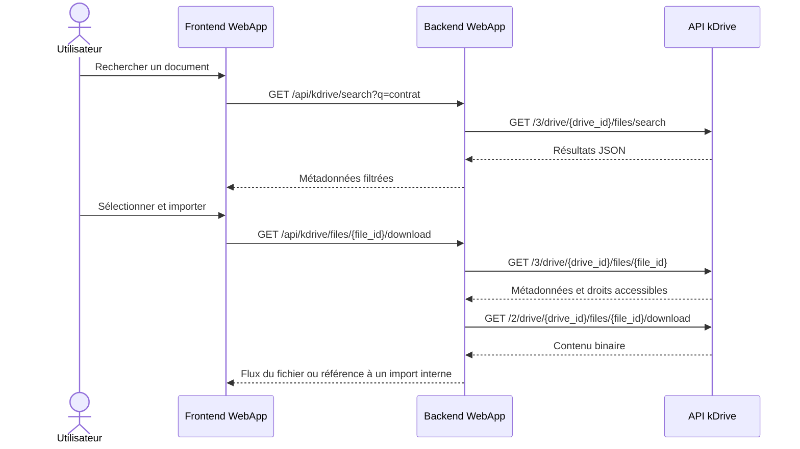

# Infomaniak kDrive — Référence API REST pour une WebApp

> **Destination :** développeur et agent Codex.  
> **Version du document :** 25 novembre 2026.  
> **Objectif principal :** connecter un kDrive existant, rechercher un fichier, récupérer ses métadonnées et importer ou télécharger son contenu depuis une application web.  
> **Périmètre secondaire :** navigation, aperçus, création, upload, renommage, déplacement, corbeille, restauration et partage.
>
> Cette synthèse technique originale s'appuie sur le portail développeur et sur le client REST publié par Infomaniak. Elle n'est pas une copie exhaustive de la spécification OpenAPI. Les méthodes et chemins confirmés sont distingués des fonctionnalités dont le contrat détaillé reste à vérifier. Aucun appel authentifié à un kDrive réel n'a été effectué.

## 1. Décision technique

Pour un sélecteur de fichiers dans une WebApp, **utiliser directement l'API REST kDrive**. MCP et WebDAV ne sont pas nécessaires. Le code du MCP officiel sert ici uniquement de référence pour vérifier les requêtes HTTP.

Flux principal :



Les routes `/api/kdrive/...` ci-dessus appartiennent à la WebApp : elles ne sont pas des routes Infomaniak. Le backend authentifie l'utilisateur de la WebApp et autorise chaque accès avant de contacter kDrive.

## 2. Sources et niveau de vérification

Les identifiants `[S1]` à `[S20]` utilisés dans le document renvoient aux liens ci-dessous. Un endpoint marqué **Portail** figure dans une page de référence consultable ; **Client officiel** signifie que sa méthode, son chemin et les paramètres indiqués sont effectivement utilisés dans le code REST d'Infomaniak.

| Réf. | Source |
|---|---|
| S1 | [Référence API Infomaniak](https://developer.infomaniak.com/docs/api) |
| S2 | [Introduction, authentification, formats, limites et erreurs](https://developer.infomaniak.com/getting-started) |
| S3 | [FAQ : créer et gérer les tokens](https://faq.infomaniak.com/2582) |
| S4 | [Client REST kDrive officiel (TypeScript)](https://github.com/Infomaniak/mcp-server-kdrive/blob/main/src/kdrive-client.ts) · [version brute du fichier](https://raw.githubusercontent.com/Infomaniak/mcp-server-kdrive/main/src/kdrive-client.ts) |
| S5 | [Dépôt officiel : configuration, outils et scope](https://github.com/Infomaniak/mcp-server-kdrive) |
| S6 | [Informations d'un drive : GET /2/drive/{drive_id}](https://developer.infomaniak.com/docs/api/get/2/drive/%7Bdrive_id%7D) |
| S7 | [Liste des drives accessibles : GET /2/drive](https://developer.infomaniak.com/docs/api/get/2/drive) |
| S8 | [Métadonnées d'un fichier ou dossier : GET v3](https://developer.infomaniak.com/docs/api/get/3/drive/%7Bdrive_id%7D/files/%7Bfile_id%7D) |
| S9 | [Recherche d'un enfant par nom](https://developer.infomaniak.com/docs/api/get/3/drive/%7Bdrive_id%7D/files/%7Bfile_id%7D/name) |
| S10 | [Upload direct v3](https://developer.infomaniak.com/docs/api/post/3/drive/%7Bdrive_id%7D/upload) |
| S11 | [Aperçu v2](https://developer.infomaniak.com/docs/api/get/2/drive/%7Bdrive_id%7D/files/%7Bfile_id%7D/preview) |
| S12 | [Corbeille v3](https://developer.infomaniak.com/docs/api/get/3/drive/%7Bdrive_id%7D/trash) |
| S13 | [Fichiers que j'ai partagés](https://developer.infomaniak.com/docs/api/get/3/drive/%7Bdrive_id%7D/files/my_shared) |
| S14 | [Taille d'un fichier/dossier](https://developer.infomaniak.com/docs/api/get/2/drive/%7Bdrive_id%7D/files/%7Bfile_id%7D/sizes) |
| S15 | [Conversion de fichier](https://developer.infomaniak.com/docs/api/post/3/drive/%7Bdrive_id%7D/files/%7Bfile_id%7D/convert) |
| S16 | [Ouverture de sessions d'upload en lot](https://developer.infomaniak.com/docs/api/post/3/drive/%7Bdrive_id%7D/upload/session/batch/start) |
| S17 | [Finalisation d'une session d'upload](https://developer.infomaniak.com/docs/api/post/3/drive/%7Bdrive_id%7D/upload/session/%7Bsession_token%7D/finish) |
| S18 | [FAQ : API Infomaniak, limites et usage](https://faq.infomaniak.com/2581) |
| S19 | [FAQ : applications OAuth2/OIDC](https://faq.infomaniak.com/2567) |
| S20 | [Déclaration des outils et paramètres du MCP officiel](https://github.com/Infomaniak/mcp-server-kdrive/blob/main/src/index.ts) |

**Attention :** le portail est interactif et certaines fiches ne sont pas extractibles sous forme de texte. Le client officiel permet de confirmer les routes principales même lorsque leur fiche détaillée n'est pas lisible. Les bornes de paramètres, filtres avancés, contrats de réponse complets et fonctionnalités périphériques doivent être vérifiés avant implémentation. Le dépôt `main` peut évoluer : relever le commit consulté lors de l'intégration définitive.

## 3. Convention API et authentification

### 3.1 URL de base et versions

```text
https://api.infomaniak.com
```

Structure : `/{version}/drive/...`. Conserver explicitement la version indiquée pour chaque opération. L'API v3 ne remplace pas uniformément la v2. En particulier, le téléchargement utilisé par le client officiel est **v2**, alors que la recherche, la navigation et l'upload direct utilisent **v3**. [S2, S4]

Pour les requêtes JSON :

```http
Authorization: Bearer <KDRIVE_TOKEN>
Accept: application/json
Content-Type: application/json
```

`Content-Type` est utile lorsqu'un corps JSON est envoyé. L'upload direct envoie au contraire `application/octet-stream`. Ne pas exiger de JSON pour les réponses de téléchargement ou d'aperçu.

### 3.2 Créer un token API personnel

1. Ouvrir le [Manager — Tokens API](https://manager.infomaniak.com/v3/ng/accounts/token/list).
2. Créer un token pour le produit kDrive, avec le scope `drive` (orthographe confirmée par [S5]).
3. Choisir une durée de validité adaptée et confirmer la création.
4. Enregistrer immédiatement le token dans le gestionnaire de secrets du serveur ; sa valeur n'est plus affichée ensuite.
5. Vérifier que le compte qui crée ce token possède les droits d'accès au drive et aux documents visés.

Le scope du token et les droits sur la ressource sont deux contrôles distincts. Un token `drive` ne rend pas tous les fichiers d'une organisation accessibles. [S2, S3, S5]

Le token API est approprié pour une WebApp personnelle ou un service interne accédant à un kDrive connu. Pour une application multi-utilisateurs accédant aux drives de comptes différents, préférer une autorisation OAuth2 par utilisateur (section 12).

### 3.3 Identifier le drive

Ouvrir kDrive dans le navigateur. Dans une URL de la forme :

```text
https://ksuite.infomaniak.com/all/kdrive/app/drive/123456/...
```

`123456` correspond au `drive_id` dans cet exemple. [S5]

Ne pas confondre :

- `drive_id` : identifiant du kDrive ;
- `account_id` : identifiant de l'organisation/du compte Infomaniak ;
- `file_id` : identifiant d'un fichier **ou** dossier ;
- `1` : identifiant de la racine logique du drive pour la navigation. [S8]

Conserver la paire `(drive_id, file_id)` pour les références aux documents ; ne pas supposer qu'un identifiant de fichier suffit dans tous les drives.

### 3.4 Variables d'environnement

Exemple `.env.example` (aucun secret réel) :

```dotenv
KDRIVE_TOKEN=
KDRIVE_ID=
# Facultatif, pour découvrir les drives d'une organisation :
KDRIVE_ACCOUNT_ID=
```

L'URL d'API doit être une constante serveur, non une valeur fournie librement par le navigateur. Ne jamais exposer `KDRIVE_TOKEN` via `NEXT_PUBLIC_`, `VITE_` ou équivalent. Ne jamais le placer dans le dépôt, les logs, les captures, un prompt Codex ou une URL.

## 4. Valider la connexion : tests manuels (lecture seule)

Les commandes ci-dessous sont prévues pour Bash/Zsh avec `curl` et `jq`. Utiliser un terminal privé, désactiver le traçage shell (`set +x`) et éviter l'historique des secrets. Les exemples emploient un token déjà fourni par un gestionnaire de secrets ou saisi avec `read -s`.

```bash
set +x
read -rsp 'Token kDrive : ' KDRIVE_TOKEN; echo
read -rp 'Identifiant kDrive : ' KDRIVE_ID
export KDRIVE_TOKEN KDRIVE_ID
BASE='https://api.infomaniak.com'
AUTH="Authorization: Bearer ${KDRIVE_TOKEN}"
```

### 4.1 Test A : vérifier le drive et le token

```bash
curl --silent --show-error --fail-with-body \
  -H "$AUTH" -H 'Accept: application/json' \
  "$BASE/2/drive/$KDRIVE_ID" | jq .
```

**Route :** `GET /2/drive/{drive_id}` [S6].

Attendu : HTTP 200, `result: "success"`, objet `data` correspondant au bon drive. Vérifier `data.id`, `data.name` et, si utile, `data.role`, `data.status`, `data.is_locked`. Ces champs figurent dans l'exemple officiel ; ne pas déduire les permissions effectives d'un seul champ.

### 4.2 Test B : vérifier l'accès à la racine

```bash
curl --silent --show-error --fail-with-body \
  -H "$AUTH" -H 'Accept: application/json' \
  "$BASE/3/drive/$KDRIVE_ID/files/1" | jq .
```

**Route :** `GET /3/drive/{drive_id}/files/1` [S8].

Attendu : succès et métadonnées d'un dossier racine. Un succès au test A ne garantit pas le succès de B ni le droit de télécharger un fichier précis.

### 4.3 Test C : lister la racine

```bash
curl --silent --show-error --fail-with-body \
  -H "$AUTH" -H 'Accept: application/json' \
  "$BASE/3/drive/$KDRIVE_ID/files/1/files" | jq .
```

**Route :** `GET /3/drive/{drive_id}/files/{folder_id}/files` [S4].

Attendu : liste d'éléments accessibles et, selon la réponse, informations de pagination. Des dossiers système/personnels/partagés peuvent apparaître ; leurs noms et identifiants réels dépendent du compte.

### 4.4 Test D : rechercher un fichier connu

Créer ou identifier préalablement via l'interface kDrive un petit fichier de test sans donnée sensible, par exemple `kdrive-test-connexion.txt`. Utiliser un nom existant, unique et connu.

```bash
curl --silent --show-error --fail-with-body --get \
  -H "$AUTH" -H 'Accept: application/json' \
  --data-urlencode 'query=kdrive-test-connexion' \
  --data-urlencode 'limit=10' \
  "$BASE/3/drive/$KDRIVE_ID/files/search" | jq .
```

**Route :** `GET /3/drive/{drive_id}/files/search` [S4].

Attendu : succès et résultat contenant le fichier connu. Noter son `id`. Une réponse vide n'implique pas un échec d'authentification ; tester la navigation vers le dossier réel et la fraîcheur de l'index.

### 4.5 Test E : vérifier les métadonnées du fichier

```bash
read -rp 'Identifiant du fichier de test : ' FILE_ID
curl --silent --show-error --fail-with-body --get \
  -H "$AUTH" -H 'Accept: application/json' \
  --data-urlencode 'with=path' \
  "$BASE/3/drive/$KDRIVE_ID/files/$FILE_ID" | jq .
```

Vérifier que `data.id` correspond au fichier souhaité, que le type est bien `file` et examiner le nom, le MIME, la taille et le chemin s'ils sont présents. Le paramètre `with=path` est listé dans la documentation de cette route. [S8]

### 4.6 Test F : télécharger le fichier de test

```bash
# Fichier temporaire : ne pas publier une réponse d'erreur comme document.
TMP_FILE=$(mktemp)
if curl --silent --show-error --fail --location \
    --proto '=https' --proto-redir '=https' \
    -H "$AUTH" \
    --output "$TMP_FILE" \
    "$BASE/2/drive/$KDRIVE_ID/files/$FILE_ID/download"; then
  echo 'Téléchargement HTTP réussi ; contrôler le contenu avant utilisation.'
  file "$TMP_FILE"
  wc -c < "$TMP_FILE"
  # Pour un fichier texte de test uniquement :
  cat "$TMP_FILE"
else
  echo 'Échec du téléchargement.' >&2
fi
rm -f "$TMP_FILE"
unset AUTH KDRIVE_TOKEN
```

**Route :** `GET /2/drive/{drive_id}/files/{file_id}/download` [S4].

Le résultat attendu est le **contenu original**, pas un objet JSON enveloppé ni une chaîne base64. Vérifier le contenu de test connu et la taille attendue. Un HTTP 2xx seul ne constitue pas une preuve d'intégrité. `curl --location` peut suivre une redirection ; ne jamais utiliser `--location-trusted` pour transférer le bearer token à un autre domaine.

**Critère de validation de connexion :** A, B, C, D, E et F réussissent et les octets correspondent au fichier de test. Aucune écriture API n'est nécessaire.

### 4.7 Facultatif : découvrir les drives via l'API

Si l'`account_id` est connu :

```bash
curl --silent --show-error --fail-with-body --get \
  -H "Authorization: Bearer $KDRIVE_TOKEN" \
  --data-urlencode "account_id=$KDRIVE_ACCOUNT_ID" \
  'https://api.infomaniak.com/2/drive' | jq .
```

Cette commande doit être lancée avec le token de nouveau chargé si le test F a été exécuté. `account_id` est un paramètre obligatoire de cette route documentée. [S7] Pour un drive connu, ce mécanisme n'est pas indispensable.

## 5. Catalogue des routes vérifiées

Tous les chemins de cette section sont relatifs à `https://api.infomaniak.com`. `{d}` = `drive_id`, `{f}` = fichier/dossier, `{p}` = dossier parent, `{dest}` = dossier de destination.

### 5.1 Lecture et accès (prioritaires)

| Méthode | Chemin | Paramètres utiles confirmés | Source |
|---|---|---|---|
| GET | `/2/drive` | `account_id` | Portail S7 |
| GET | `/2/drive/{d}` | `with` (ex. `quota`, `capabilities`) | Portail S6 |
| GET | `/3/drive/{d}/files/search` | `query`, `limit`, `directory_id`, `depth` | Client officiel S4, S20 |
| GET | `/3/drive/{d}/files/{p}/files` | `type[]`, `cursor` | Client officiel S4 |
| GET | `/3/drive/{d}/files/{f}` | `with` (ex. `path`, `hash`, `capabilities`, `etag`) | Portail S8, client S4 |
| GET | `/2/drive/{d}/files/{f}` | Version également utilisée par le client | Client officiel S4 |
| GET | `/3/drive/{d}/files/{p}/name` | `name` | Portail S9 |
| GET | `/2/drive/{d}/files/{f}/download` | Aucun paramètre requis montré | Client officiel S4 |
| GET | `/2/drive/{d}/files/{f}/preview` | `as=pdf` ou `as=text` | Portail S11 |
| GET | `/2/drive/{d}/files/{f}/sizes` | `depth=folder` ou `unlimited` | Portail S14 |
| GET | `/3/drive/{d}/files/recents` | `type[]` | Client officiel S4 |
| GET | `/3/drive/{d}/files/shared_with_me` | `type[]` | Client officiel S4 |
| GET | `/3/drive/{d}/files/my_shared` | `with`, pagination par curseur dans la réponse | Portail S13 |
| GET | `/3/drive/{d}/trash` | `with`, pagination par curseur dans la réponse | Portail S12 |

### 5.2 Écriture, organisation et partage (extensions)

| Méthode | Chemin | Corps / paramètres principaux confirmés | Source |
|---|---|---|---|
| POST | `/3/drive/{d}/files/{p}/directory` | JSON `name` | Client officiel S4 |
| POST | `/3/drive/{d}/upload` | Query `directory_id`, `file_name`, `total_size` ; corps binaire | Portail S10, client S4 |
| POST | `/2/drive/{d}/files/{f}/rename` | JSON `name` | Client officiel S4 |
| POST | `/3/drive/{d}/files/{f}/move/{dest}` | Pas de corps requis dans le client | Client officiel S4 |
| DELETE | `/2/drive/{d}/files/{f}` | Mise à la corbeille selon le client | Client officiel S4, S20 |
| POST | `/2/drive/{d}/trash/{f}/restore` | JSON `destination_directory_id` | Client officiel S4 |
| POST | `/2/drive/{d}/files/{f}/link` | JSON `right` et options | Client officiel S4, S20 |
| POST | `/2/drive/{d}/files/{f}/access/invitations` | Query `lang` ; JSON `emails`, `right`, `message` facultatif | Client officiel S4 |
| POST | `/3/drive/{d}/files/{f}/convert` | Contrat détaillé à vérifier avant usage | Portail S15 |
| POST | `/3/drive/{d}/upload/session/batch/start` | Contrat de lot à consulter | Portail S16 |
| POST | `/3/drive/{d}/upload/session/{session_token}/finish` | Métadonnées facultatives, contrat S17 | Portail S17 |

**Politique d'intégration :** n'activer aucune route d'écriture pour le premier sélecteur de fichiers. Les présenter comme fonctionnalités supplémentaires, avec contrôles d'accès, confirmation des opérations destructives et tests dans un dossier dédié.

## 6. Recherche et navigation

### 6.1 Recherche globale

```http
GET /3/drive/123456/files/search?query=contrat&limit=10
Authorization: Bearer <token>
```

Paramètres connus par [S4, S20] :

| Paramètre | Type | Utilisation |
|---|---|---|
| `query` | chaîne | Texte recherché ; encoder avec `URLSearchParams` |
| `limit` | entier | Nombre de résultats demandé ; le client officiel utilise `10`, pas une borne maximale attestée |
| `directory_id` | entier | Limiter la recherche à un dossier |
| `depth` | chaîne | `child` (enfants directs) ou `unlimited` (sous-arborescence) ; utiliser avec `directory_id` |

Exemple ciblé :

```bash
curl -fsS --get -H "$AUTH" \
  --data-urlencode 'query=contrat client' \
  --data-urlencode 'limit=10' \
  --data-urlencode 'directory_id=456' \
  --data-urlencode 'depth=unlimited' \
  "$BASE/3/drive/$KDRIVE_ID/files/search"
```

Ne pas supposer que `query` garantit une recherche strictement par nom, une correspondance de sous-chaîne, un classement précis ou une indexation de tous les contenus. Tester ces comportements sur PDF, DOCX, XLSX, images, fichiers récents, noms accentués et homonymes. Le client officiel renvoie le JSON brut de recherche ; son code ne prouve pas tous les filtres ni le schéma détaillé de pagination de cette route. Ne pas inventer de paramètres `page`, `cursor` ou `type[]` pour la recherche sans vérifier sa fiche ou une réponse réelle.

### 6.2 Navigation et pagination

```http
GET /3/drive/123456/files/1/files
GET /3/drive/123456/files/456/files?type%5B%5D=file
GET /3/drive/123456/files/456/files?type%5B%5D=dir
GET /3/drive/123456/files/456/files?cursor=<curseur-encodé>
```

Laisser `type[]` absent pour recevoir fichiers et dossiers. Le client officiel documente `has_more` et `cursor` pour les listes [S5]. Pour chaque page suivante, transmettre le curseur reçu et conserver le dossier et les filtres initiaux. Traiter le curseur comme une chaîne opaque, ne pas le décoder ni le construire. Interrompre en cas d'absence ou répétition de curseur alors que `has_more` est vrai.

Pseudo-code (forme normalisée côté application) :

```text
cursor = null
repeat:
    response = listDirectory(folderId, cursor)
    traiter response.data
    if response.has_more != true: stop
    if response.cursor est absent ou déjà vu: erreur de pagination
    cursor = response.cursor
```

Ne pas parcourir tout le drive à chaque frappe clavier. Une recherche par navigation récursive est un repli, pas le comportement par défaut. Pour de gros volumes ou une recherche par nom strictement fiable, envisager un index local des métadonnées (sans contenu binaire) avec politique d'invalidation et respect des droits.

### 6.3 Résoudre un nom exact dans un dossier

```http
GET /3/drive/123456/files/456/name?name=Contrat.pdf
```

Cette route documentée [S9] vise un enfant d'un dossier connu. Elle ne remplace pas une recherche globale. Toujours gérer les erreurs d'accès ou d'absence ; pour résoudre un chemin, progresser par dossier à partir d'une racine autorisée.

## 7. Métadonnées et contrats de réponse

### 7.1 Enveloppe JSON

L'API générale utilise un champ `result`, avec `data` en cas de succès et `error` pour les échecs. Certaines fiches kDrive déclarent aussi `asynchronous` comme résultat possible. [S2, S8, S10]

Exemple pédagogique, non capturé sur un vrai compte :

```json
{
  "result": "success",
  "data": {
    "id": 98765,
    "name": "Contrat.pdf",
    "type": "file",
    "drive_id": 123456,
    "parent_id": 456,
    "size": 245760,
    "mime_type": "application/pdf"
  }
}
```

L'illustration ne constitue pas une définition OpenAPI. Les métadonnées sont différentes selon le type de ressource et les options de réponse ; certains champs peuvent être absents ou nuls. Valider les données à l'exécution. Ne pas coder en dur les identifiants ou les valeurs illustratives.

### 7.2 Informations enrichies

```http
GET /3/drive/123456/files/98765?with=path
GET /3/drive/123456/files/98765?with=capabilities
GET /3/drive/123456/files/98765?with=etag
```

Parmi les valeurs de `with` déclarées par la fiche S8 : `path`, `hash`, `capabilities`, `etag`, `parents`, `parents.path`, `version`, `sharelink`, `users`, `teams`, `conversion_capabilities`. Tester la syntaxe exacte de combinaison de plusieurs valeurs avant de l'utiliser. Ne pas exiger tous ces enrichissements lors d'une simple recherche.

### 7.3 Modèle interne recommandé (distinct du contrat fournisseur)

```ts
export interface KDriveFileRef {
  driveId: string;
  fileId: string;
  name: string;
  kind: 'file' | 'dir' | 'other';
  mimeType?: string;
  sizeBytes?: number;
  parentId?: string;
  path?: string;
}
```

Le nom et le chemin facilitent l'affichage mais ne doivent pas servir d'identifiant primaire. Pour des IDs JSON numériques, vérifier `Number.isSafeInteger` avant conversion en chaîne ; éviter toute perte de précision. Ne pas confondre `size` et `storage_size`. Pour les timestamps, vérifier l'unité du champ (plusieurs routes documentent des secondes Unix).

## 8. Télécharger et importer dans la WebApp

### 8.1 Téléchargement du fichier original

```http
GET /2/drive/{drive_id}/files/{file_id}/download
Authorization: Bearer <token>
```

Le client officiel lit la réponse en `ArrayBuffer` [S4]. Pour une WebApp, préférer le **streaming des octets** lorsque la taille n'est pas négligeable. Le base64 est un choix de transport du MCP, pas une obligation de l'API REST.

Deux usages à distinguer :

- **Télécharger sur le poste utilisateur :** le backend renvoie un flux avec `Content-Disposition: attachment` et un nom correctement encodé.
- **Importer dans l'application :** le backend transmet le flux au pipeline métier ou au stockage de l'application, puis retourne une référence interne et le statut de l'import. Ne déclarer le succès qu'après persistance ou traitement confirmé.

Une référence externe seule suffit si l'application veut conserver un lien vers kDrive plutôt qu'une copie. Elle ne garantit pas que le fichier restera accessible ou inchangé ultérieurement.

### 8.2 Miniatures et prévisualisation

```http
GET /2/drive/{drive_id}/files/{file_id}/preview
GET /2/drive/{drive_id}/files/{file_id}/preview?as=pdf
GET /2/drive/{drive_id}/files/{file_id}/preview?as=text
```

La fiche [S11] décrit la prévisualisation et les options de conversion `pdf` et `text`. Les formats compatibles et le comportement asynchrone éventuel restent à tester. Pour un fichier protégé, elle mentionne l'en-tête `x-kdrive-file-password` ; ne pas le journaliser. Ne pas confondre un aperçu et l'original. Pour servir des contenus actifs, notamment HTML/SVG, privilégier un téléchargement ou un visualiseur isolé ; ne pas injecter leur texte dans le DOM.

### 8.3 Sécurité des flux

- Vérifier la session utilisateur de la WebApp et l'autorisation sur le drive **et** le fichier demandé. Un `file_id` présenté par le frontend n'est pas une preuve d'autorisation.
- Si le token couvre plusieurs espaces mais que l'application doit se limiter à un dossier, vérifier côté serveur l'appartenance effective à ce sous-arbre. Ne pas se fier au chemin envoyé par le navigateur.
- Revalider les droits au téléchargement, même après une recherche réussie.
- Contrôler statut HTTP, MIME, taille et, lorsque possible, intégrité. Ne pas enregistrer silencieusement une réponse d'erreur JSON en tant que fichier. Un vrai fichier JSON doit toutefois rester téléchargeable : ne pas rejeter tous les MIME JSON.
- Autoriser uniquement HTTPS ; si le fournisseur redirige vers une URL de stockage, ne pas transmettre le bearer token à l'hôte tiers. Vérifier la politique de redirection et les hôtes permis contre les réponses réelles ; refuser les destinations inattendues.
- Utiliser un nom assaini, indépendant du chemin local, et des limites de taille/temps adaptées. Éviter la traversée de chemin, les archives dangereuses et les téléchargements excessifs.
- Pour un import persistant, gérer un stockage temporaire, le nettoyage des transferts interrompus et l'idempotence de la finalisation.

## 9. Opérations de gestion (facultatives)

Les exemples suivants supposent que `BASE`, `AUTH`, `KDRIVE_ID` et les identifiants de test sont configurés comme en section 4. Les valeurs illustratives doivent être remplacées. Ne pas lancer ces commandes sur des documents importants. Ne pas exécuter ces opérations automatiquement pendant le test de connexion.

### 9.1 Créer un dossier

```bash
curl -fsS -X POST -H "$AUTH" -H 'Content-Type: application/json' \
  --data '{"name":"Imports WebApp"}' \
  "$BASE/3/drive/$KDRIVE_ID/files/$PARENT_ID/directory"
```

### 9.2 Déposer un fichier binaire (upload direct)

```bash
LOCAL_FILE='./kdrive-test-connexion.txt'
FILE_NAME=$(basename "$LOCAL_FILE")
SIZE=$(wc -c < "$LOCAL_FILE" | tr -d '[:space:]')
QUERY=$(jq -nr --arg id "$PARENT_ID" --arg name "$FILE_NAME" --arg size "$SIZE" \
  '"directory_id=\($id|@uri)&file_name=\($name|@uri)&total_size=\($size|@uri)"')

curl -fsS -X POST -H "$AUTH" \
  -H 'Content-Type: application/octet-stream' \
  --data-binary "@$LOCAL_FILE" \
  "$BASE/3/drive/$KDRIVE_ID/upload?$QUERY"
```

Le corps est le fichier brut, sans encodage base64 ni multipart. La taille `total_size` est calculée en octets. [S4, S10]

La documentation [S10] indique de ne pas dépasser 1 GB par upload direct. [S16] recommande l'upload direct pour les fichiers de moins de 100 MB. En cas de fichier volumineux, recourir aux sessions d'upload : ouvrir la session, transférer les chunks à l'`upload_url` fournie, finaliser avec le `session_token`. La documentation de lot précise une durée maximale de 4 h, jusqu'à 1 GB par chunk et 1 000 sessions par lot. Vérifier le contrat exact de création unitaire, de chunks, de reprise et de collision avant de développer ce mécanisme ; ces paramètres ne sont pas tous extractibles ici. Les conditions d'écrasement d'un fichier existant et `If-Match` doivent aussi être confirmées avant activation. Ne jamais réessayer automatiquement une écriture ambiguë.

### 9.3 Renommer un fichier ou dossier

```bash
curl -fsS -X POST -H "$AUTH" -H 'Content-Type: application/json' \
  --data '{"name":"Nouveau-nom.pdf"}' \
  "$BASE/2/drive/$KDRIVE_ID/files/$FILE_ID/rename"
```

### 9.4 Déplacer

```bash
curl -fsS -X POST -H "$AUTH" \
  "$BASE/3/drive/$KDRIVE_ID/files/$FILE_ID/move/$DEST_ID"
```

Vérifier le dossier destination et ses droits ; traiter les conflits, les déplacements interdits et les résultats asynchrones. Ne pas déplacer les dossiers système par défaut.

### 9.5 Mettre à la corbeille et restaurer

```bash
# DESTRUCTIF : mise à la corbeille de l'élément ciblé.
curl -fsS -X DELETE -H "$AUTH" \
  "$BASE/2/drive/$KDRIVE_ID/files/$FILE_ID"

# Lire la corbeille.
curl -fsS -H "$AUTH" "$BASE/3/drive/$KDRIVE_ID/trash"

# Restaurer dans un dossier autorisé.
curl -fsS -X POST -H "$AUTH" -H 'Content-Type: application/json' \
  --data "{\"destination_directory_id\":$DEST_ID}" \
  "$BASE/2/drive/$KDRIVE_ID/trash/$FILE_ID/restore"
```

Le `DELETE` est utilisé par le client officiel pour la mise à la corbeille [S4, S20]. La suppression définitive est hors périmètre de ce guide : aucune route de purge ne doit être devinée ni exposée par défaut.

### 9.6 Partager par lien

```bash
curl -fsS -X POST -H "$AUTH" -H 'Content-Type: application/json' \
  --data '{"right":"inherit","can_download":true,"can_edit":false}' \
  "$BASE/2/drive/$KDRIVE_ID/files/$FILE_ID/link"
```

Le client officiel accepte `right` parmi `inherit`, `password`, `public`, et les options `password`, `valid_until` (timestamp Unix), `can_download`, `can_edit`, `can_request_access`. [S20] Vérifier les combinaisons autorisées dans la fiche de route. Aucun lien public n'est requis pour télécharger depuis la WebApp ; l'accès authentifié est préférable. La modification du partage doit être volontaire et confirmée.

### 9.7 Inviter un utilisateur par e-mail

```bash
curl -fsS -X POST -H "$AUTH" -H 'Content-Type: application/json' \
  --data '{"emails":["destinataire@example.com"],"right":"read"}' \
  "$BASE/2/drive/$KDRIVE_ID/files/$FILE_ID/access/invitations?lang=fr"
```

Les valeurs de droits exposées par le MCP officiel sont `read`, `write`, `manage` ; `message` est facultatif. [S4, S20] L'opération peut notifier des tiers et doit rester hors du MVP.

### 9.8 Autres fonctionnalités à examiner seulement si nécessaires

Le catalogue ci-dessus couvre les opérations confirmées utiles au projet. Pour une gestion documentaire avancée, consulter [S1] pour les contrats détaillés de copie, versions/historique, favoris, commentaires, activités, verrous, miniatures, exports ZIP, écrasement conditionnel, gestion avancée des permissions et suppression définitive. Ces domaines ne sont pas documentés ici route par route : ne pas extrapoler une méthode ou un chemin à partir de leur nom. Une fiche officielle supplémentaire est disponible pour la conversion [S15] ; sa présence ne suffit pas à définir le corps de requête.

## 10. Erreurs, pagination, limites et résilience

### 10.1 Erreurs

Inspecter le code HTTP **et** `result` pour les réponses JSON. Ne jamais transformer un `result: "error"` en succès, même si une réponse HTTP était 2xx. Pour `result: "asynchronous"`, ne pas annoncer une opération terminée ; vérifier le mécanisme officiel de suivi propre à la route.

| Statut | Interprétation / comportement du client |
|---|---|
| 200 / 201 | Lire et valider le résultat attendu |
| 3xx | Gérer les redirections selon la politique de sécurité |
| 400 / 422 | Corriger la requête ; pas de nouvelle tentative identique |
| 401 | Token absent, invalide, expiré ou scope insuffisant ; vérifier la configuration |
| 403 | Ressource interdite au compte ou à l'utilisateur ; ne pas contourner |
| 404 | Drive, fichier, dossier ou route introuvable ; revérifier l'identifiant et la version |
| 409 / 412 | Si renvoyés : conflit/précondition ; rafraîchir les métadonnées, pas d'écrasement silencieux |
| 429 | Limitation de débit ; attendre selon `Retry-After` s'il est présent |
| 5xx | Erreur serveur ; réessai borné uniquement si approprié |

[S2] documente les codes généraux ; 400, 409, 412 et 429 sont aussi des cas défensifs standards à traiter, sans prétendre qu'ils sont renvoyés par chaque endpoint kDrive.

### 10.2 Limitation de débit

Infomaniak annonce **60 requêtes par minute** au niveau de son API, avec des contraintes spécifiques possibles par URI. [S2, S18]

Recommandations applicatives (valeurs non imposées par Infomaniak) :

- Debounce de 400–600 ms et recherche à partir de 2 ou 3 caractères.
- Annuler ou ignorer les recherches devenues obsolètes.
- Limiteur partagé côté backend (pas seulement par onglet) ; garder une marge sous le plafond et tenir compte des autres usages du token.
- Cache court des résultats et métadonnées, isolé par utilisateur/permissions, avec invalidation lors de modifications ou de révocation d'accès.
- Réessais bornés avec délai exponentiel et jitter pour les lectures transitoirement en échec ; respecter `Retry-After`.
- Aucune boucle de retry automatique pour 401, 403, 404 ou validation ; aucune répétition automatique d'une mutation à l'issue inconnue.
- Prévoir un timeout court pour les requêtes JSON et un timeout de transfert adapté pour les fichiers ; propager l'annulation utilisateur.

## 11. Exemple d'adaptateur TypeScript côté serveur

Exemple autonome fondé sur `fetch` (runtime serveur moderne, Node.js 20+). Ce choix de langage est illustratif : adapter au framework réel du projet. Il s'agit de code original proposé pour l'intégration, pas du SDK Infomaniak ni d'un module complet d'authentification. Ne pas importer ce module dans un bundle frontend.

Le client ci-dessous est limité à la lecture. Il ne suit pas les redirections automatiquement pour les téléchargements : l'intégration doit confirmer le comportement réel du fournisseur avant d'autoriser un hôte de stockage supplémentaire. Cette décision empêche un transfert accidentel de secrets mais peut nécessiter une adaptation si le téléchargement retourne un 3xx.

```ts
const BASE = 'https://api.infomaniak.com';

type Obj = Record<string, unknown>;
const isObj = (v: unknown): v is Obj =>
  typeof v === 'object' && v !== null && !Array.isArray(v);

function checkedId(value: string | number): string {
  if (typeof value === 'number' && !Number.isSafeInteger(value)) {
    throw new Error('Identifiant numérique non sûr');
  }
  const id = String(value);
  if (!/^[1-9]\d*$/.test(id)) throw new Error('Identifiant invalide');
  return id;
}

export class KDriveApiError extends Error {
  constructor(public readonly status: number, public readonly code: string) {
    super(`kDrive : ${code} (HTTP ${status})`);
  }
}

export class KDriveClient {
  private readonly driveId: string;
  private readonly token: string;

  constructor(token: string, driveId: string) {
    if (!token.trim()) throw new Error('Token kDrive manquant');
    this.token = token;
    this.driveId = checkedId(driveId);
  }

  private path(version: 2 | 3, suffix = ''): string {
    return `/${version}/drive/${this.driveId}${suffix}`;
  }

  private async json(path: string, params?: URLSearchParams): Promise<Obj> {
    const url = new URL(path, BASE);
    if (params) url.search = params.toString();
    const res = await fetch(url, {
      headers: {
        Authorization: `Bearer ${this.token}`,
        Accept: 'application/json',
      },
      cache: 'no-store',
      redirect: 'error',
      signal: AbortSignal.timeout(15000),
    });

    let body: unknown;
    try { body = await res.json(); } catch {
      throw new KDriveApiError(res.status, 'invalid_json');
    }
    if (!res.ok || !isObj(body) || body.result !== 'success') {
      const code = isObj(body) && isObj(body.error) &&
        typeof body.error.code === 'string'
        ? body.error.code : 'unexpected_response';
      throw new KDriveApiError(res.status, code);
    }
    return body;
  }

  driveInfo() {
    return this.json(this.path(2));
  }

  info(fileId: string) {
    return this.json(this.path(3, `/files/${checkedId(fileId)}`),
      new URLSearchParams({ with: 'path' }));
  }

  async checkConnection() {
    const drive = await this.driveInfo();
    if (!isObj(drive.data) ||
        (typeof drive.data.id !== 'number' && typeof drive.data.id !== 'string') ||
        checkedId(drive.data.id) !== this.driveId) {
      throw new Error('Drive inattendu');
    }
    const root = await this.info('1');
    if (!isObj(root.data) || root.data.type !== 'dir') {
      throw new Error('Racine kDrive inattendue');
    }
    return { connected: true, driveId: this.driveId };
  }

  search(query: string, directoryId?: string, depth: 'child' | 'unlimited' = 'unlimited') {
    const q = query.trim();
    if (q.length < 2 || q.length > 200) throw new Error('Recherche invalide');
    const params = new URLSearchParams({ query: q, limit: '10' });
    if (directoryId !== undefined) {
      params.set('directory_id', checkedId(directoryId));
      params.set('depth', depth);
    }
    return this.json(this.path(3, '/files/search'), params);
  }

  list(folderId = '1', cursor?: string, type?: 'file' | 'dir') {
    const params = new URLSearchParams();
    if (cursor) params.set('cursor', cursor);
    if (type) params.set('type[]', type);
    return this.json(this.path(3, `/files/${checkedId(folderId)}/files`), params);
  }

  // Appeler uniquement après le contrôle d'accès de la WebApp.
  // Le consommateur doit contrôler le type/longueur et fermer/annuler le flux.
  async openDownload(fileId: string, signal?: AbortSignal): Promise<Response> {
    const id = checkedId(fileId);
    const response = await fetch(new URL(this.path(2, `/files/${id}/download`), BASE), {
      headers: { Authorization: `Bearer ${this.token}` },
      cache: 'no-store',
      redirect: 'manual',
      signal: signal ?? AbortSignal.timeout(120000),
    });
    if (response.status >= 300 && response.status < 400) {
      await response.body?.cancel();
      throw new KDriveApiError(response.status, 'redirect_requires_validation');
    }
    if (!response.ok || !response.body) {
      await response.body?.cancel();
      throw new KDriveApiError(response.status, 'download_failed');
    }
    return response;
  }
}

// Initialisation exclusivement dans le backend :
// const client = new KDriveClient(process.env.KDRIVE_TOKEN!, process.env.KDRIVE_ID!);
// await client.checkConnection();
```

Notes à Codex :

- Le résultat de `checkConnection()` valide le drive et les métadonnées de la racine ; il ne valide pas encore la recherche ni le téléchargement. Exécuter aussi les tests C à F.
- Les méthodes `search()` et `list()` retournent ici une enveloppe JSON validée minimalement. Créer un mapping runtime après inspection des vraies réponses. Ne pas inventer les champs absents.
- Les contraintes de longueur de recherche, timeout et `limit=10` sont des choix applicatifs. Ajuster après test.
- Compléter ce client avec un limiteur de débit, un traitement de `Retry-After`, une gestion d'annulation et des erreurs adaptées au framework. Ne pas exposer les réponses amont non filtrées.
- Si la réponse de téléchargement est redirigée, ajouter une politique explicite d'hôtes et de redirections validée, jamais un transfert indiscriminé du bearer token.

## 12. Architecture WebApp et OAuth2

### 12.1 Routes internes proposées (MVP)

| Route WebApp | Rôle | Appels kDrive |
|---|---|---|
| `GET /api/kdrive/status` | Vérification de connexion sans secret | Drive v2 + racine v3 (cache court) |
| `GET /api/kdrive/search?q=...` | Recherche de fichiers | Search v3 |
| `GET /api/kdrive/folders/{id}/files?cursor=...` | Navigation facultative | List v3 |
| `GET /api/kdrive/files/{id}` | Informations du document | Info v3 |
| `GET /api/kdrive/files/{id}/download` | Télécharger vers le navigateur | Info v3 + Download v2 |
| `POST /api/kdrive/import` | Importer une copie dans le système métier | Info v3 + Download v2 + stockage local/app |

Le dernier endpoint **n'écrit pas dans kDrive** ; il crée un import dans l'application, si nécessaire. `POST /api/kdrive/import` peut recevoir `{ "fileId": "98765" }`, le drive étant imposé par la configuration serveur. Une route de téléchargement qui renvoie un flux et un import métier ne sont pas la même opération.

### 12.2 Interface recommandée : `KDriveFilePicker`

- Recherche avec temporisation ; états chargement, résultats, aucun résultat, erreur, quota.
- Afficher nom, type, taille et chemin uniquement si ces données sont disponibles.
- Permettre d'ouvrir les dossiers ou de filtrer les fichiers côté application ; ne pas sélectionner un dossier comme fichier.
- Conserver `driveId` + `fileId` de la sélection ; ne pas se baser sur le nom.
- Action « Télécharger » ou « Importer dans l'application », progression et possibilité d'annulation si le framework le permet.
- Aucun token visible dans le navigateur. Aucun lien de partage public créé par défaut.

### 12.3 Variante multi-utilisateurs : OAuth2

Créer une application OAuth2/OIDC dans le [Manager — Applications](https://manager.infomaniak.com/v3/ng/accounts/applications/list). La documentation [S2, S19] donne les URLs suivantes :

```text
Autorisation : https://login.infomaniak.com/authorize
Échange de token : https://login.infomaniak.com/token
```

Pour un flux utilisateur, vérifier dans le Manager le type d'application, les scopes autorisés (notamment `drive`), l'URI de redirection et les modalités exactes du flux, d'obtention et de renouvellement des tokens. Utiliser un flux Authorization Code avec protections `state` et PKCE si le type d'application le permet ; stocker les secrets et éventuels refresh tokens côté serveur. Ne pas supposer que toutes les applications OAuth2 obtiennent automatiquement le scope `drive` ou un refresh token.

Une application multi-utilisateurs doit isoler les tokens et résultats de chaque identité. Ne jamais substituer un token administrateur global à des autorisations individuelles sans une politique d'accès explicitement définie.

## 13. Plan de validation pour Codex

### 13.1 Tests unitaires et intégration simulée

- [ ] Configuration absente : échec explicite, aucun secret exposé.
- [ ] Les routes v2/v3, méthodes, paramètres et encodages correspondent au catalogue.
- [ ] Le token est transmis en en-tête uniquement et les URLs de requête sont fixes ou construites à partir d'IDs validés.
- [ ] Réponse JSON `success`, `error`, réponse malformée, 401, 403, 404, 422, 429 et 5xx.
- [ ] Pagination : page suivante, fin, curseur absent, répétition du curseur.
- [ ] Recherche : caractères accentués, espaces, apostrophes, `&`, résultats vides et réponses arrivant dans le désordre.
- [ ] Téléchargement : fichier binaire non corrompu, erreur amont non importée, vrai fichier JSON, transfert interrompu, taille limite.
- [ ] Redirection : pas de fuite du bearer token, destinations inattendues refusées.
- [ ] Utilisateur non autorisé : recherche, accès direct par ID et téléchargement refusés.
- [ ] Aucun appel d'écriture kDrive durant les tests du MVP.

### 13.2 Tests réels, avec l'accord de l'utilisateur

- [ ] Création du token `drive` et configuration dans le backend local.
- [ ] Identification correcte du drive.
- [ ] Tests A à F de la section 4, sur un petit fichier de test connu.
- [ ] Recherche sur plusieurs types de documents et noms similaires ; noter les comportements réellement observés.
- [ ] Test de dossier personnel/partagé si pertinent pour le compte.
- [ ] Téléchargement et comparaison des octets (ou hash calculé localement) avec un original connu.
- [ ] Test de révocation/expiration en utilisant un jeton de test et vérification des messages UI.
- [ ] Vérification des redirections, en-têtes de réponse, délais et taille limite dans l'environnement réel.
- [ ] Si des fonctions d'écriture sont demandées ultérieurement, les tester exclusivement dans un dossier jetable avec confirmation.

### 13.3 Critères d'acceptation du MVP

1. Le backend valide le token et le drive sans exposer de secret.
2. L'utilisateur peut trouver un fichier accessible et le sélectionner par ID.
3. Le fichier original peut être téléchargé ou importé sans corruption.
4. Les accès non autorisés et les erreurs sont correctement traités.
5. Le flux ne crée ni lien public ni modification sur kDrive.
6. Le sélecteur reste utilisable sous le quota API documenté.

## 14. Prompt de démarrage à transmettre à Codex

```text
Lis docs/infomaniak-kdrive-api.md et inspecte l'architecture du projet existant.

Objectif : intégrer un sélecteur de fichiers Infomaniak kDrive qui permet de
valider la connexion, rechercher un document, le sélectionner et récupérer
ses octets pour un téléchargement ou un import dans la WebApp.

Utilise uniquement l'API REST officielle, sans MCP ni WebDAV.
Le token KDRIVE_TOKEN et KDRIVE_ID doivent rester côté serveur.
Commence par un adaptateur kDrive en lecture seule, puis une route de statut,
une route de recherche, la récupération des métadonnées et le téléchargement
binaire. Respecte précisément les versions v2/v3 indiquées dans le document.
Adapte l'interface et les routes internes au framework et aux conventions
existants. Ne change pas la stack sans nécessité.

Ne suppose pas le schéma complet de recherche ni des paramètres non confirmés.
Utilise les liens officiels et les réponses réelles pour vérifier les contrats.
Mets en place des tests simulés, un contrôle des permissions par utilisateur,
la pagination des listes, un limiteur de débit, des erreurs sûres, des
transferts binaires en streaming et une politique de redirection explicite.

Ne crée aucun lien public et ne modifie, ne supprime ni ne déplace aucun
fichier kDrive. Les routes d'écriture sont documentées à titre d'extension.
N'invente pas de token et ne le demande pas dans le chat : prévoir un
.env.example et un chargement local sécurisé. Laisse les tests nécessitant
un vrai token désactivés tant qu'il n'a pas été configuré.

Fournis le code, les tests, la procédure locale et les points restant à
valider sur le compte réel. Ne déclare pas la connexion ou le téléchargement
fonctionnels tant que les tests réels n'ont pas réussi.
```

## 15. Limites de cette référence

- Les chemins de recherche, de liste, de téléchargement, de mutations et de partage du client REST officiel ont été relevés dans son code public, mais n'ont pas été exécutés avec les identifiants d'un compte réel.
- L'offre kDrive exacte, les droits du compte, les filtres de recherche disponibles, la fraîcheur de l'index, les tailles maximales de téléchargement, les comportements de redirection et les variantes d'aperçu ne sont pas validés pour ce compte.
- Le portail complet et sa spécification interactive n'ont pas pu être exportés. Les opérations périphériques et les paramètres non confirmés sont volontairement exclus du contrat de développement initial.
- Les exemples TypeScript, cURL, conventions de routes internes et seuils de debounce sont des propositions d'implémentation, pas des engagements officiels d'Infomaniak. Adapter au projet et valider avec les tests.

**Priorité absolue :** `GET drive v2` → `GET racine v3` → `GET search v3` → `GET file v3` → `GET download v2`. Cette chaîne couvre le besoin de recherche et d'import sans dépendance supplémentaire.
